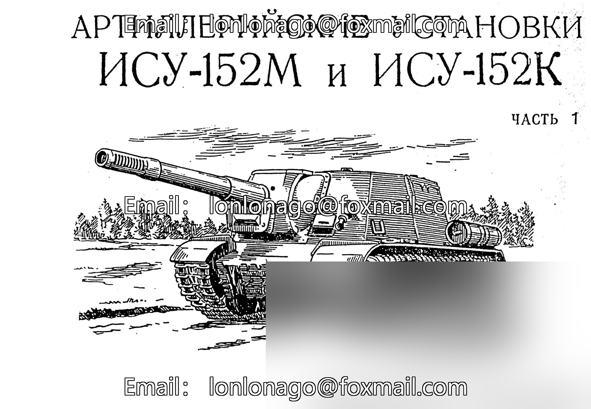
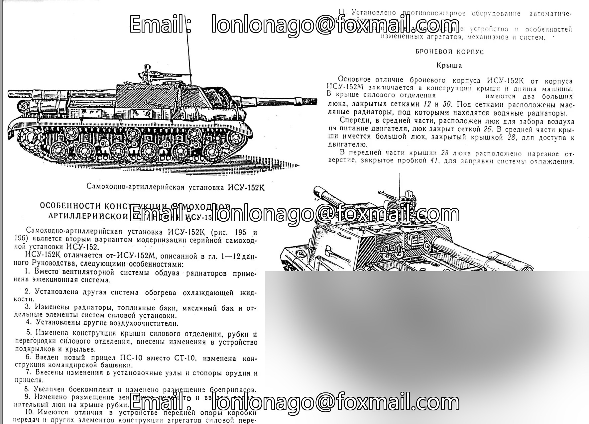
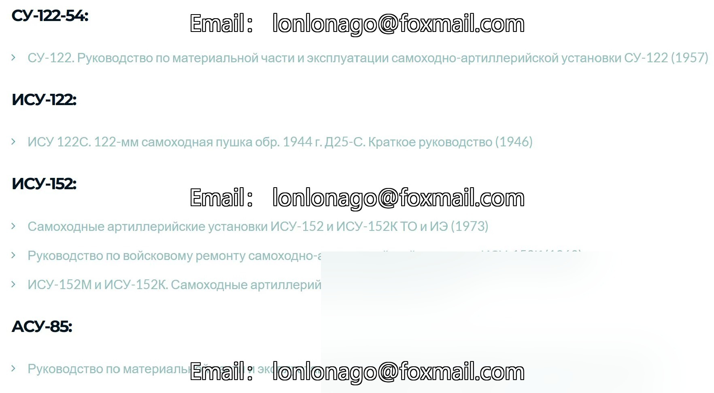
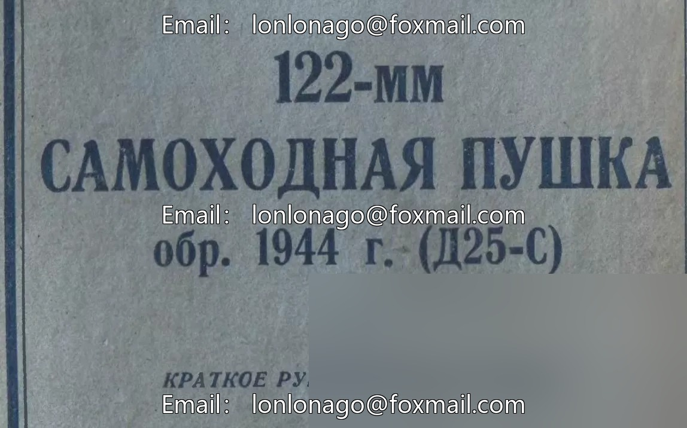
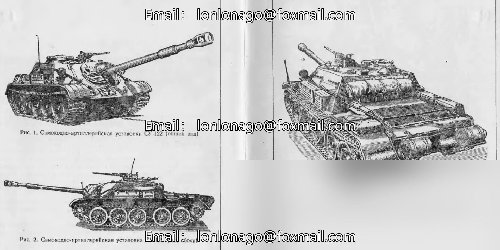
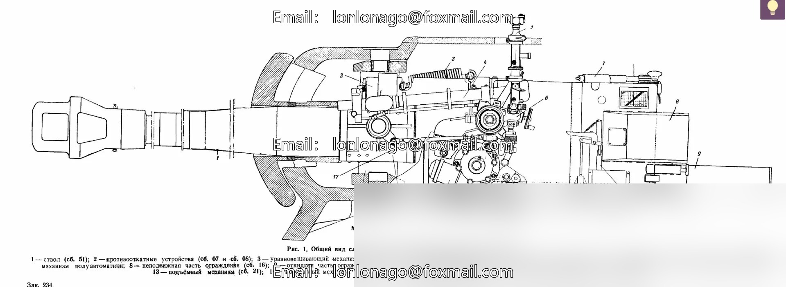
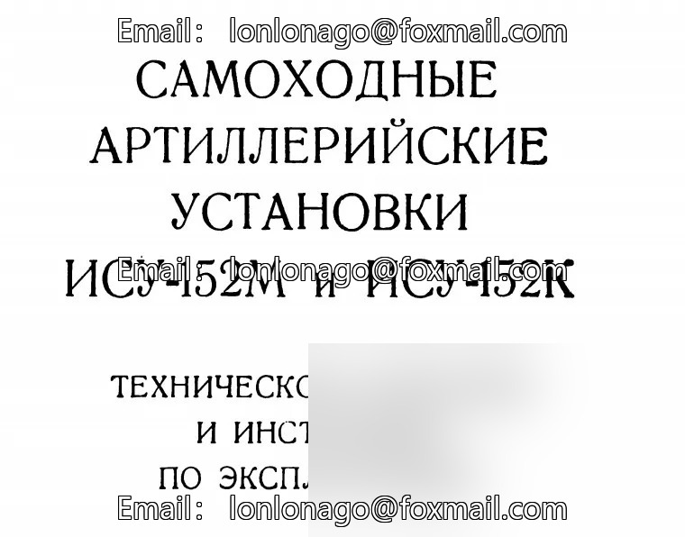
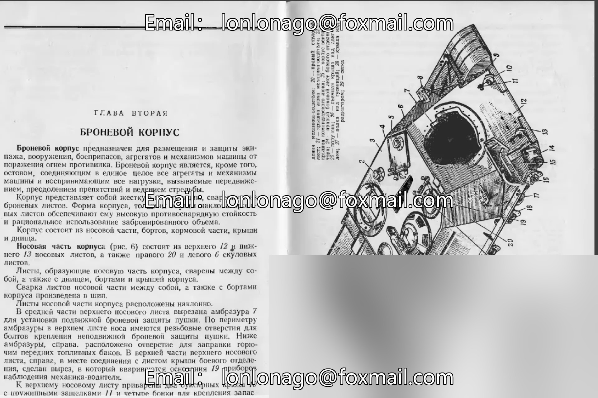

# Soviet four self-propelled artillery (SU-122-54, ISU-122, ISU)

## Body

Information on the technical manuals and operational guides for four Soviet self-propelled artillery (S-U-122-54, I-S-U-122, I-S-U-152, A-S-U-85).
1. Core content classification
1. S-U-122-54 (122mm self-propelled artillery)
"С-U-122. Guide to material part and operation... (1957)"
Core content: technical and operation guides for the improved model after the war, covering artillery structure, maintenance processes, and combat operation specifications.
Background: Developed based on the T-54 tank chassis, served from the 1950s, emphasizing mobility combined with firepower.

2. ISU-122 (122-mm heavy self-propelled gun)
"The ISU 122С. 122-mm self-propelled gun prototypes. 1944 g. D25-S. Short guide" (1946)
Core content: A simplified operation guide urgently written at the end of WWII, compatible with the D-25S gun (same model as IS-2 tank).
Features: Emphasizes wartime rapid deployment requirements, with the document focusing on basic operation and fault troubleshooting.
3. ISU-152 (152-mm heavy self-propelled gun)
Manual list:
"The ISU-152 and ISU-152K To and I.E." (1973)

Articulated Cold War revised version, covering technical maintenance (TO) and daily operation (IE).
《Maintenance Guide for ISU-152K》 (1960)
Afterwar improved model (152K) battlefield repair guide, adapted to upgraded suspension systems.
《ISU-152M/152K. Part 1》
Iterative upgrade: from the WWII "animal killer" to the Cold War improved model (152K/M), reflecting continuous optimization of firepower and reliability.
Multi-purpose: the manual is divided into three categories of combat, repair, and maintenance, reflecting its long-term service status as an equipment.
4. ASU-85 (85-mm airborne self-propelled howitzer)

《Guidelines for Material Section and Operation of SU-85》

Soviet four self-propelled cannons include SU-122-54, ISU-122, ISU-152 and ASU-85; technical manual and operation guide information is provided in detail.

<!-- AI_ENRICHED -->

## Images

## Payment

Here is a pay link on Stripe ( https://buy.stripe.com/3cs8yP7sY87d0vu9AB ). Please contact me lonlonago@foxmail.com after funding $89, and I will send you a complete data files , thank you!

